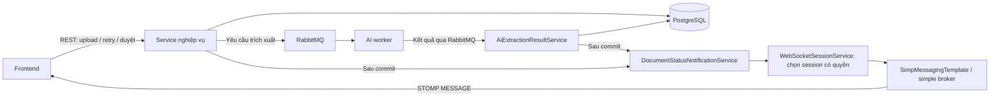

# WebSocket cập nhật trạng thái tài liệu

## 1. Phạm vi và kiến trúc

Backend đẩy thay đổi `documents.current_state` của tài liệu `ACTIVE` xuống frontend. Các thao tác upload, retry, sửa/duyệt và xóa vẫn thực hiện qua REST API.

- Công nghệ: Spring WebSocket + STOMP, kết nối WebSocket native, không dùng SockJS.
- Broker: Spring simple broker trong bộ nhớ, phù hợp triển khai **một instance**.
- RabbitMQ phục vụ trao đổi yêu cầu/kết quả AI; không làm broker cho WebSocket.
- Session, subscription và bộ đếm hết hạn token nằm trong bộ nhớ của instance.



## 2. Kết nối, xác thực và phân quyền

| Thành phần | Giá trị |
|---|---|
| Endpoint | `/ws`, local: `ws://localhost:8080/ws` |
| Origin được phép | `http://localhost:5173` |
| Xác thực | Header của STOMP `CONNECT`: `Authorization: Bearer <accessToken>` |
| Destination FE subscribe | `/user/queue/document-status` |
| Broker prefix | `/queue` |
| User destination prefix | `/user` |
| Application prefix | `/app`; hiện không có lệnh nghiệp vụ WebSocket cho client |

Luồng kết nối:

1. FE login để lấy access token và refresh token.
2. FE mở WebSocket `/ws`. HTTP handshake được cho phép trước xác thực; quyền truy cập được kiểm tra ở STOMP `CONNECT`.
3. `WebSocketSecurityInterceptor` dùng `JwtDecoder` kiểm tra token, `userId` và `role`.
4. `AccountTokenValidator` kiểm tra tài khoản active, email, vai trò và `tokenVersion` khớp dữ liệu hiện tại.
5. `WebSocketSessionService` gắn token vào session và đặt lịch đóng kết nối tại thời điểm token hết hạn.
6. FE subscribe `/user/queue/document-status`. Subscribe destination khác và client `SEND` bị từ chối.

Người nhận được backend xác định từ tài khoản:

- `EMPLOYEE`: nhận tài liệu có `uploadedById` bằng `userId` của mình.
- `MANAGER`: nhận mọi tài liệu active; chưa có phạm vi đơn vị.
- Mỗi kết nối dùng **session ID do server cấp làm tên principal**. Backend gửi `convertAndSendToUser(sessionId, "/queue/document-status", payload)` để tách riêng từng kết nối. Các tab cùng tài khoản đều có thể nhận thông báo.
- Token/tài khoản được kiểm tra lại trước khi chọn người nhận. Session có token không còn hợp lệ bị loại và đóng kết nối.

## 3. Luồng phát sự kiện

### Upload và gửi yêu cầu AI

1. `DocumentUploadService` kiểm tra file, lưu MinIO và metadata trong database; file bị từ chối được ghi nhận bằng `UPLOADED_FAILED`.
2. Với mỗi tài liệu mới active, đăng ký thông báo bằng `statusNotifications.afterCommit(document, null)`.
3. Sau commit, gửi trạng thái ban đầu; tiếp đó callback upload gọi `ExtractionMessageService.sendExtract()` cho file đã upload thành công.
4. Gửi RabbitMQ thành công → `PROCESSING`; không gửi được → `PENDING_FAILURE`.
5. `DocumentRepository.updateDispatchStateIfMatching()` lưu chuyển trạng thái bằng transaction `REQUIRES_NEW`, chỉ cập nhật khi trạng thái còn `UPLOADED`.
6. Nếu thực sự cập nhật được bản ghi, `ExtractionMessageService` gọi `notifyCommitted()` sau khi transaction riêng hoàn tất.

### Nhận kết quả AI

1. Kết quả RabbitMQ đi qua `ExtractionMessageService.receiveResult()` đến `AiExtractionResultService.saveResult()`.
2. Chỉ xử lý kết quả khi tài liệu đang `PROCESSING`.
3. Cùng một transaction lưu kết quả trích xuất, hóa đơn/dòng hóa đơn khi có, review task khi cần và trạng thái tài liệu.
4. Sau commit mới gửi `EXTRACT_SUCCESS`, `REVIEW_REQUIRED` hoặc `EXTRACT_FAILED`.

### Retry và duyệt

- Retry: khóa tài liệu có quyền truy cập, gửi yêu cầu AI, lưu `PROCESSING` hoặc `PENDING_FAILURE`, rồi gửi thông báo sau commit nếu trạng thái thay đổi. Trường hợp dispatch thất bại vẫn commit `PENDING_FAILURE` trước khi API trả lỗi.
- Sửa/xác nhận hóa đơn: `DocumentService.updateExtractionResult()` lưu hóa đơn, đánh dấu hoàn tất review task và chuyển sang `EXTRACT_SUCCESS`; thông báo được gửi sau commit nếu trạng thái thay đổi.

### Quy tắc gửi chung

`DocumentStatusNotificationService.afterCommit()` chụp payload tại thời điểm thay đổi và đăng ký `TransactionSynchronization.afterCommit()`. `DocumentStatusChangedEvent` là snapshot nội bộ gồm chủ tài liệu và payload, không phải sự kiện lưu trong database hay Spring application event được publish tự động.

Trước khi gửi, `notifyCommitted()` đọc lại tài liệu bằng transaction chỉ đọc `REQUIRES_NEW` để xác nhận vẫn active, chọn session có quyền rồi gửi từng session.

- Rollback, tài liệu inactive hoặc `currentState` không đổi: không gửi.
- Xóa mềm chuyển `status` sang `INACTIVE`: không có event xóa.
- Chỉ sửa nội dung hóa đơn nhưng trạng thái không đổi: không có event.
- Lỗi gửi được ghi log và không đảo ngược dữ liệu đã commit; không có cơ chế retry/replay thông báo.

## 4. Trạng thái và payload

| Luồng | Trạng thái |
|---|---|
| Tạo tài liệu | `UPLOADED` hoặc `UPLOADED_FAILED` |
| Gửi yêu cầu AI | `UPLOADED` → `PROCESSING` hoặc `PENDING_FAILURE` |
| Kết quả AI | `PROCESSING` → `EXTRACT_SUCCESS`, `REVIEW_REQUIRED` hoặc `EXTRACT_FAILED` |
| Retry | `UPLOADED`, `EXTRACT_FAILED`, `PENDING_FAILURE` → `PROCESSING` hoặc `PENDING_FAILURE` |
| Sửa/xác nhận hóa đơn | → `EXTRACT_SUCCESS` khi vượt qua kiểm tra API |

Retry chỉ áp dụng cho tài liệu active, file đã upload thành công và có `objectKey`. API sửa/xác nhận hóa đơn hiện không giới hạn trạng thái đầu vào chỉ ở `REVIEW_REQUIRED`.

STOMP gửi frame `MESSAGE` trên subscription; JSON không có trường tên event/type:

```json
{
  "documentId": "12345678-1234-1234-1234-123456789012",
  "currentState": "EXTRACT_SUCCESS",
  "errorCode": null,
  "errorMessage": null
}
```

Payload chỉ có bốn trường trên. Thông tin lỗi có thể xuất hiện khi thất bại hoặc cần review. Không có trạng thái cũ, timestamp, version, event ID hay dữ liệu hóa đơn/thống kê.

Khi nhận event, transaction tương ứng đã commit: FE có thể đọc kết quả bằng `GET /api/v1/documents/{documentId}/extraction-result`, tải lại danh sách, review task và `GET /api/v1/documents/summary`. Thống kê được tính từ database khi gọi API. Dữ liệu API có thể mới hơn snapshot event nếu có thay đổi tiếp theo.

## 5. Token hết hạn, reconnect và trách nhiệm FE

- Access token có thời hạn 1 giờ. Khi hết hạn, backend chủ động đóng socket với close code `1008`; disconnect sẽ xóa session, token và lịch hết hạn.
- FE gọi `POST /api/v1/auth/refresh-token` với body `{"refreshToken":"..."}`, không gửi header `Authorization`.
- Refresh token có thời hạn 7 ngày, chỉ dùng một lần. Refresh thành công trả cặp token mới; FE phải lưu thay thế cả hai. Refresh thất bại `401` thì yêu cầu đăng nhập lại.
- Refresh không thay token của socket đang mở. FE cần tạo kết nối mới bằng access token mới và subscribe lại.
- Backend không tự reconnect, không gửi snapshot khi subscribe và không phát lại event bị bỏ lỡ. Sau reconnect, FE cần gọi API lấy lại dữ liệu hiện tại.
- Polling dự phòng, thông báo mất kết nối và xử lý form đang chỉnh sửa thuộc FE; backend hiện chưa có version/optimistic locking cho đồng bộ form.
- Logout: gọi `POST /api/v1/auth/logout` với access token hợp lệ và body refresh token; backend thu hồi refresh token đó. FE xóa cả hai token và đóng socket. Access token đã cấp vẫn còn hiệu lực đến hết hạn.

Broker giữ thứ tự gửi trong từng kết nối nhưng payload không hỗ trợ xác định thứ tự phiên bản giữa các cập nhật đồng thời. REST API là nguồn dữ liệu để đồng bộ lại.

## 6. Các file liên quan

Đường dẫn Java bên dưới tính từ `src/main/java/org/involens_be/`.

| File | Trách nhiệm |
|---|---|
| `config/WebSocketConfig.java` | Endpoint, origin, broker, thứ tự frame và lifecycle transport |
| `config/WebSocketSecurityInterceptor.java` | Xác thực CONNECT, giới hạn subscribe và chặn client SEND |
| `service/WebSocketSessionService.java` | Quản lý socket/token/timer, kiểm tra quyền và chọn session nhận |
| `service/DocumentStatusNotificationService.java` | Snapshot sau commit, kiểm tra active và gửi thông báo |
| `service/DocumentStatusChangedEvent.java` | Snapshot nội bộ: owner ID và payload |
| `dto/response/DocumentStatusResponse.java` | JSON bốn trường gửi FE |
| `service/DocumentUploadService.java` | Điểm phát trạng thái tạo tài liệu và retry |
| `service/ExtractionMessageService.java` | RabbitMQ và thông báo sau khi lưu trạng thái dispatch |
| `service/AiExtractionResultService.java` | Lưu kết quả AI và đăng ký thông báo sau commit |
| `service/DocumentService.java` | Điểm phát khi sửa/xác nhận làm thay đổi trạng thái |
| `repository/DocumentRepository.java` | Cập nhật dispatch có điều kiện, truy vấn tài liệu active |
| `entity/DocumentEntity.java`, `common/DocumentState.java` | Trạng thái active và enum trạng thái xử lý |
| `config/SecurityConfig.java`, `config/AccountTokenValidator.java` | Handshake được phép, decoder JWT và kiểm tra tài khoản |
| `service/JwtService.java`, `service/AuthService.java`, `controller/AuthController.java` | Cấp access token, REST login/refresh/logout |
| `service/RefreshTokenService.java` | Cấp, xoay và thu hồi refresh token theo phiên |
| `entity/RefreshTokenEntity.java`, `repository/RefreshTokenRepository.java` | Lưu hash refresh token và khóa khi sử dụng |
| `dto/request/RefreshTokenRequest.java`, `dto/response/LoginResponse.java` | Request refresh/logout và response cặp token |

Các file ngoài thư mục Java:

- `pom.xml`: dependency `spring-boot-starter-websocket`.
- `src/main/resources/application.properties`: thời hạn và cấu hình JWT.
- `docker-compose.yml`: công bố cổng ứng dụng `8080`; WebSocket sử dụng cùng cổng HTTP.
- `src/test/java/org/involens_be/config/WebSocketSecurityInterceptorTest.java`: xác thực, phân quyền, hết hạn và luồng STOMP qua broker Spring.
- `src/test/java/org/involens_be/service/DocumentStatusNotificationServiceTest.java`: commit/rollback, lọc active, snapshot và lỗi gửi.
- Các test service tài liệu/AI: kiểm tra điểm tích hợp thông báo. `RefreshTokenServiceTest`, `AuthServiceTest`, `AuthControllerTest`: luồng refresh/logout phục vụ kết nối lại.
